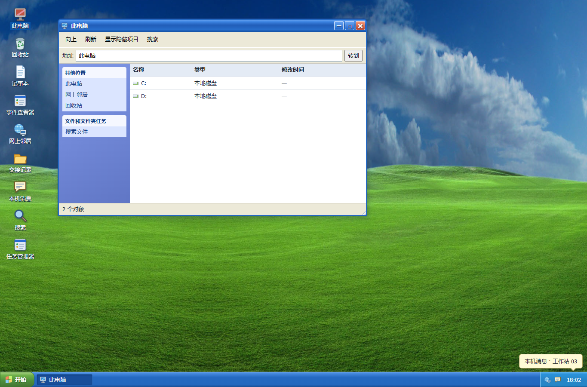

# 此电脑 · 最后一次交接

撤场前，你要整理一台办公室工作站的 D 盘，然后关机。交接记录上写着，今晚没有未完成的工作。

**[开机试玩](https://chenbaitang388-dot.github.io/this-computer/)**

点击「开机」进入浏览器全屏。用鼠标双击桌面图标，右键查看可用操作。Esc 退出全屏，开始菜单可以重新进入。进度保存在当前浏览器里，下次点「继续交接」即可恢复。

本仓库发布可独立通关的网页序章。所有文件、网络连接和系统提示都在游戏中模拟。打开「本机消息」可以跟桌面恢复服务交谈。搜索、运行、任务管理器和控制面板可从开始菜单访问。



## 本地运行

在仓库根目录执行：

```sh
python -m http.server 8000
```

在桌面浏览器打开 http://localhost:8000。无需安装前端依赖。

## 测试

```sh
node --test
```

浏览器端到端脚本位于 `tests/playthrough.py`，需要 Python Playwright 和 Chrome。脚本包含序章解法。

## 素材

桌面壁纸为 [A hill covered with green grass](https://commons.wikimedia.org/wiki/File:A_hill_covered_with_green_grass.jpg)，作者 arifovic Jelic Zora…，按 [CC BY-SA 3.0](https://creativecommons.org/licenses/by-sa/3.0/) 使用。仓库内保留原始图像文件，游戏中的夜间模式通过 CSS 叠加色调。
